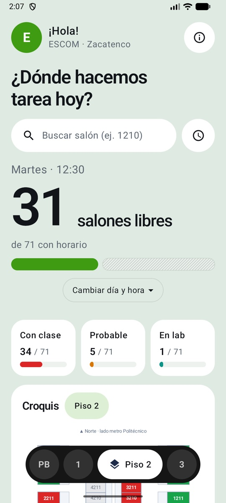
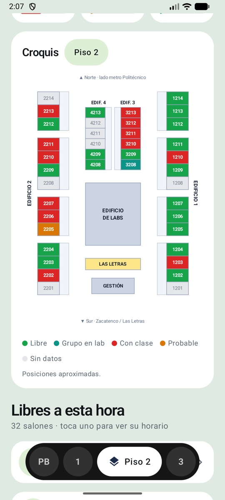
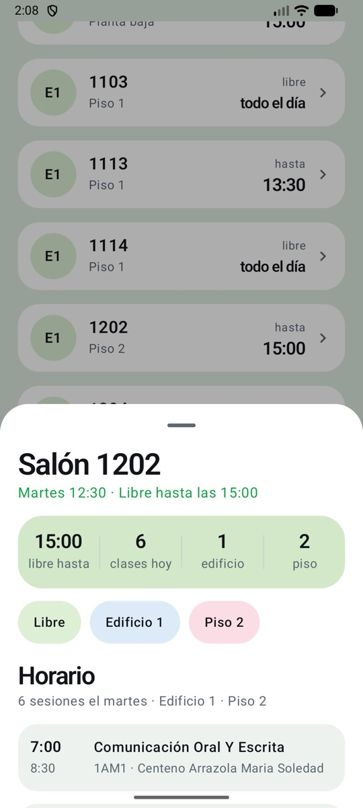
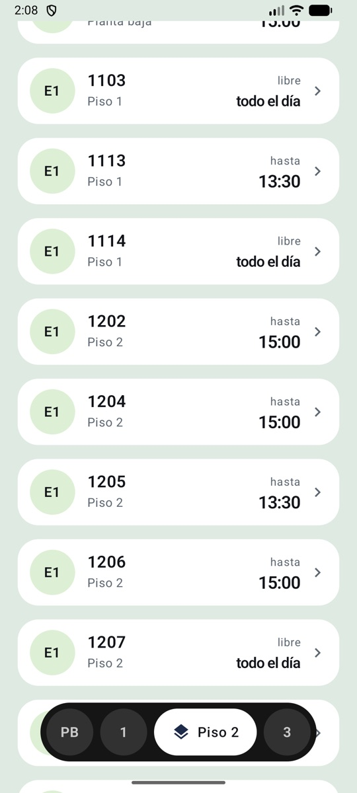
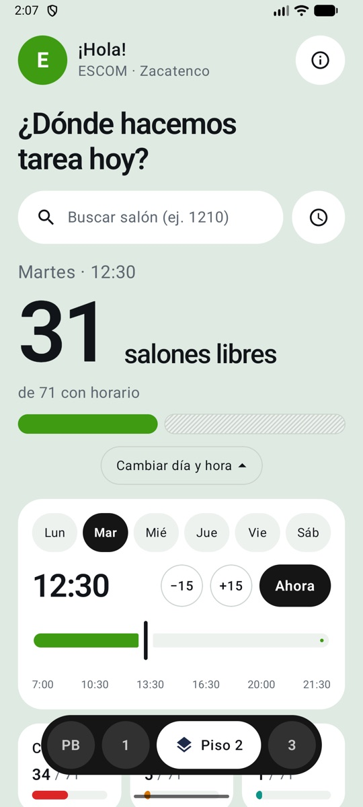
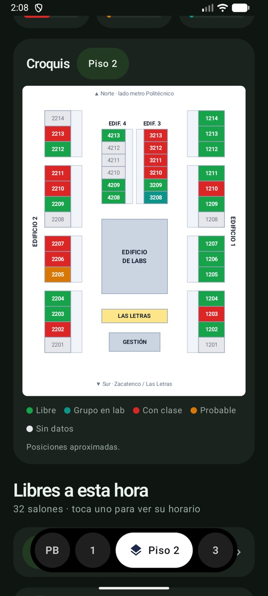
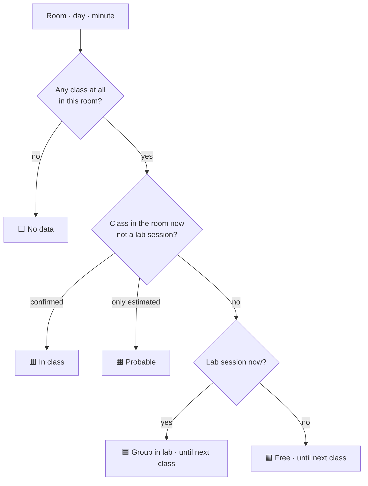
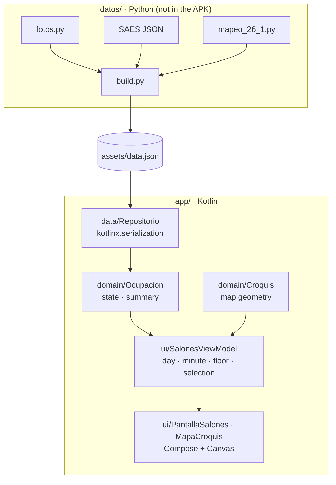

<div align="center">


# Salones Libres · ESCOM

**Find an empty classroom to study in at ESCOM (IPN, Zacatenco), right now or at any day and time.**

A floor-by-floor map of the campus colors every classroom by whether it has a class at that moment. Tap a room to see its full schedule for the day. Everything works offline.


-3DDC84?logo=android&logoColor=white)


[Features](#features) · [Screenshots](#screenshots) · [How it works](#how-it-works) · [Data](#data) · [Getting started](#getting-started) · [Architecture](#architecture) · [Roadmap](#roadmap)

</div>

---

## Why

Between classes at ESCOM, finding a quiet room to do homework usually means walking the halls and peeking through doors. The schedules exist, but they are spread across the SAES portal (one page per degree, shift, and semester) and the paper sheets taped outside each room. This app combines all of them into a single answer: *which rooms are empty now, and until when?*

| Who | What they need | Example |
|---|---|---|
| 🎒 Students with a free period | A room that will stay empty long enough | "Something free until 15:00 near Building 1?" |
| 👥 Study groups | A room for several people without interrupting a class | Prep for a team project after the morning shift |
| 🗓️ Planners | To know in advance what will be free | "What's empty on Thursday at 13:30?" |

## Screenshots

<table>
  <tr>
    <td align="center"><br/><sub><b>Free rooms right now</b></sub></td>
    <td align="center"><br/><sub><b>Floor map</b></sub></td>
    <td align="center"><br/><sub><b>Room schedule</b></sub></td>
  </tr>
  <tr>
    <td align="center"><br/><sub><b>Free until…</b></sub></td>
    <td align="center"><br/><sub><b>Any day and time</b></sub></td>
    <td align="center"><br/><sub><b>Dark mode</b></sub></td>
  </tr>
</table>

<sub>Captured on the Android emulator, Tuesday 12:30, with the 2026-27/1 term schedules.</sub>

## Features

**At a glance**
- 🔢 A big count of **free rooms right now**, with a bar showing how much of the campus is free.
- 🗺️ **Floor-by-floor map** of Buildings 1–4 (ground floor, 1, 2, and the third floor of Building 3), with every room colored by status.
- 📋 A list of free rooms sorted by building, each with **how long it stays free** ("until 15:00" or "free all day").
- 🔎 **Room search**: type a room code like `1210` and the app jumps to its floor and opens it.

**Five honest states** instead of a yes/no

| Color | State | Meaning |
|---|---|---|
| 🟩 Green | Free | No class registered; shows when the next one starts |
| 🟦 Teal | Group in lab | The class is marked as a lab session, so the group should be downstairs (sometimes they stay) |
| 🟥 Red | In class | Confirmed by the SAES or by the sheet outside the room |
| 🟧 Amber | Probable | A class is expected, but the room was estimated from the term's room distribution |
| ⬜ Gray | No data | The room doesn't appear in any schedule (offices, cubicles) |

**Room detail**
- ⏱️ When the current class ends or the room stops being free, how many classes it has that day, building, and floor.
- 📚 The full schedule for the day with subject, group, and professor, highlighting the current class and flagging estimated or lab sessions.

**Comfort**
- ⏰ **Now** button using Mexico City time. On Sundays and outside class hours it snaps to the nearest valid time (7:00–21:30).
- 🌙 Light and dark themes. The map keeps its own light background so it stays readable in both.
- 📴 **100 % offline**: no network permission, no accounts, no analytics.

> The UI is in Spanish (es‑MX), the language of its users.

## How it works

For any room, day, and minute, `Ocupacion.estado()` applies four rules in order:



Estimated classes that contradict confirmed data are ignored for occupancy, but still shown in the room's schedule so nothing is hidden.

The campus map is drawn on a Compose `Canvas` in a 360×500 virtual space and scaled to the screen. The same geometry is used to hit-test taps, so a tap always lands on the room that was drawn there.

| Challenge | Cause | Solution |
|---|---|---|
| The SAES has no room for ~150 classes | Most of the AI degree groups show room `X` | Fill gaps with the term's room distribution and mark them **estimated** |
| The SAES doesn't mark lab sessions | Only the sheet outside each room has the "L" | Transcribe the sheets; those sessions free the room but show as *group in lab* |
| Sources disagree | Rooms change after the SAES is published | Priority: photo of the sheet > SAES > distribution; conflicts get flagged, not silently dropped |
| Spelling differs between sources | Accents, abbreviations, capitalization | Subjects are compared without accents, in upper case, by substring |
| No official floor plan | Room layout isn't published | A schematic map with the assumptions made explicit in code (`Croquis.BLOQUES`) and in the UI |

## Data

The schedules ship inside the app as `assets/data.json` (~180 KB), produced by a small Python pipeline in [`datos/`](datos):

```bash
python3 datos/build.py
```

Sources, from highest to lowest priority:

1. **Photos** of the "HORARIO · SALÓN XXXX" sheets taped outside each room → [`fotos.py`](datos/fotos.py). The only source that marks lab sessions.
2. **SAES** class schedules for every degree, shift, and semester of the current term → `horarios_saes_2026-11-13.json`.
3. **Room distribution 26-1** (group → room) for classes the SAES leaves without a room → [`mapeo_26_1.py`](datos/mapeo_26_1.py). Agrees with the SAES on ~82 % of classes.

On every run the script reports gaps filled by photos, SAES corrections, discarded estimates, lab sessions applied, and the groups still waiting to be confirmed by a photo.

**Current dataset:** 2,036 class sessions · 71 rooms · 136 groups · 261 professors.

| | Sessions |
|---|---|
| Confirmed (SAES or photo) | 1,854 |
| Estimated from the room distribution | 170 |
| Estimated but contradicting confirmed data (ignored) | 12 |
| Lab sessions ("L") | 89 |

## Getting started

### Prerequisites

- [Android Studio](https://developer.android.com/studio) (includes JDK 17+ and the Android SDK; the project compiles against SDK 37).
- Python 3 only if you want to regenerate the data.

### Build and run

```bash
git clone https://github.com/AaronUgalde/SalonesLibresESCOM.git
cd SalonesLibresESCOM
./gradlew :app:assembleDebug
```

Or open the folder in Android Studio and press **▶ Run**.

<details>
<summary><b>☕ "Unable to locate a Java Runtime" on macOS</b></summary>

Use the JDK bundled with Android Studio:

```bash
export JAVA_HOME="/Applications/Android Studio.app/Contents/jbr/Contents/Home"
```

</details>

### Tests

```bash
./gradlew :app:testDebugUnitTest
```

10 JVM unit tests cover the occupancy rules (confirmed vs. estimated, lab sessions, "free until", ignored conflicts), the campus map geometry, and the snapping of the current time to class hours.

## Architecture

A single screen with a deliberately small stack. The occupancy logic and the map geometry live in `domain/` as **pure Kotlin**, so they are tested without an emulator.



<details>
<summary><b>Project structure</b></summary>

```
app/src/main/
├── assets/data.json           # generated by datos/build.py
└── java/mx/escom/salones/
    ├── data/Horarios.kt       # Clase model + JSON parsing
    ├── domain/Ocupacion.kt    # occupancy rules, summary, time helpers
    ├── domain/Croquis.kt      # campus map geometry per floor
    └── ui/                    # ViewModel, screen, Canvas map, theme
app/src/test/                  # JVM unit tests
datos/                         # Python pipeline + raw sources
```

</details>

### Tech stack

| Area | Technology |
|---|---|
| Language | Kotlin 2.4 |
| UI | Jetpack Compose · Material 3 · custom `Canvas` map |
| State | `AndroidViewModel` + Compose state |
| Data | Bundled JSON parsed with kotlinx.serialization |
| Data pipeline | Python 3 (standard library only) |
| Tests | JUnit 4 |

> **Why no database, network, or DI?** About 2,000 sessions fit in a 180 KB file that loads instantly, and the schedule only changes once per term. A plain JSON asset plus a pure-Kotlin domain layer keeps the app tiny, fully offline, and easy to test.

## Roadmap

- [x] Occupancy engine with confirmed, estimated, and lab states
- [x] Floor-by-floor campus map with tap-to-open rooms
- [x] Free-room list with "free until", room search, and any day/time
- [x] Data pipeline merging SAES, room sheets, and the room distribution
- [x] Light and dark themes
- [ ] Confirm the real room layout per block and fine-tune the map
- [ ] More room-sheet photos (mainly Building 4) to replace estimates
- [ ] School calendar: holidays, non-working days, and exam weeks
- [ ] Live reports ("this room is actually taken") to correct the data
- [ ] The 2022 Classrooms and Labs building

## Acknowledgments

- Class schedules: the SAES portal of ESCOM-IPN and the schedule sheets posted outside each classroom.

> **Disclaimer:** Salones Libres ESCOM is an independent student project. It is not affiliated with or endorsed by the Instituto Politécnico Nacional or ESCOM. "Free" only means no class is registered: there may be tutoring sessions or last-minute changes, and the room layout on the map is approximate.

## License

No license has been chosen yet. Until one is added, all rights are reserved by the author.

---

<div align="center">
<sub>Built by <a href="https://github.com/AaronUgalde">Aaron Ugalde</a> · Made at ESCOM 🇲🇽</sub>
</div>
